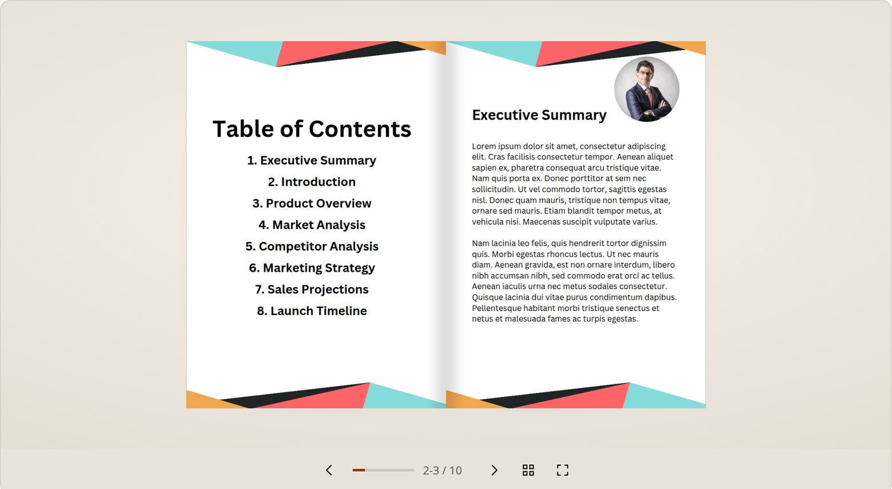
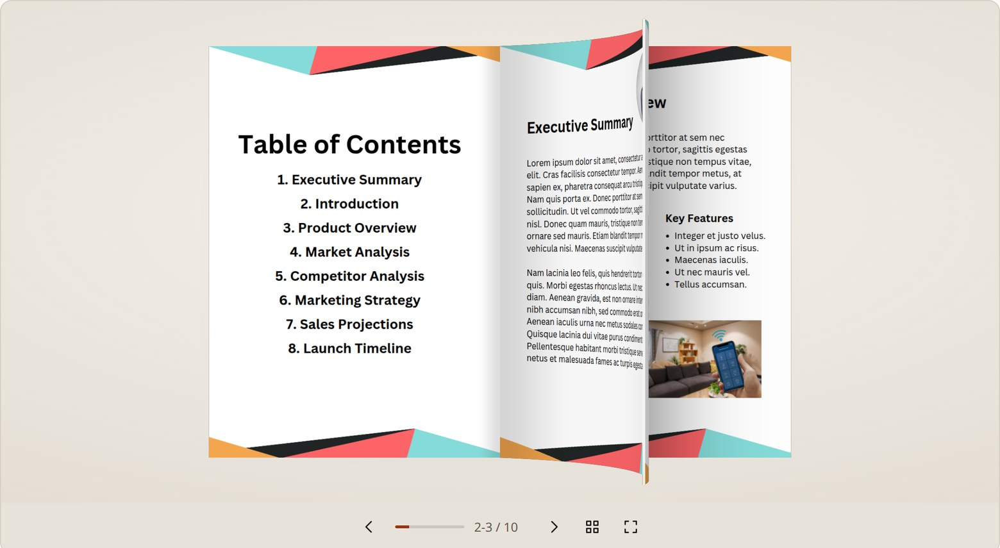
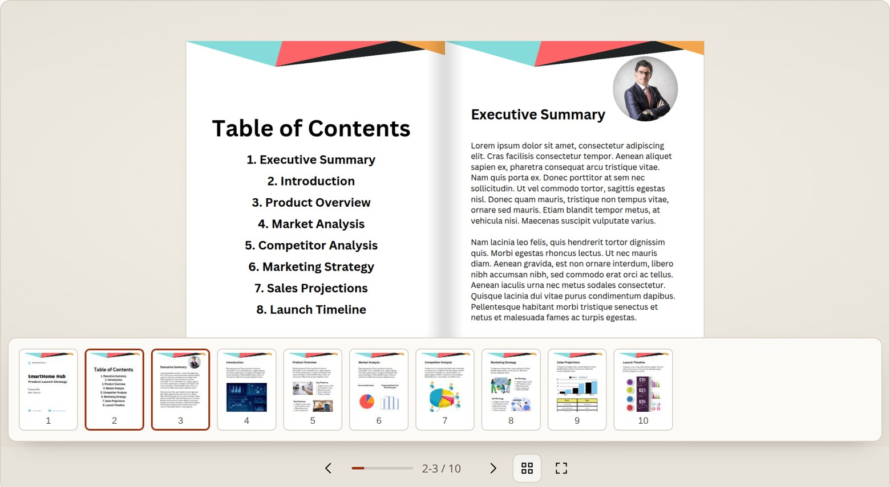

# flip-pdf

Turn a PDF into a page-turning flipbook. One script tag, one container, no
build step and no runtime dependencies beyond the copy of PDF.js that ships in
the bundle.

The page turn is real geometry, not a CSS `rotateY` on a rectangle: the sheet
is a curved strip whose arc length is preserved as it swings, so the page
foreshortens, catches light on its curve, and casts a moving shadow on the page
underneath.



```
npm install flip-pdf
```

Status: 0.x. The API is small and stable enough to use, but minor versions may
still change it. Everything the tests cover is listed in
[`docs/ARCHITECTURE.md`](docs/ARCHITECTURE.md).

One file, 533 kB gzipped, which is mostly the bundled PDF.js. No dependencies
of its own: not jQuery, not an animation library, not a framework.

Building with a coding agent? [`AGENTS.md`](AGENTS.md) is the short integration
guide written for one, and [`llms.txt`](llms.txt) is the machine-readable index.

## What the turn looks like

The sheet is caught here partway through a turn: it has left the binding, the
free edge has curled past vertical, and the page underneath is already showing.
The white line down its edge is the cut edge of the paper.



Everything else stays out of the way. Page thumbnails open in a drawer over the
book, and below 720 px the viewer drops to a single page instead of shrinking a
spread to nothing:




## Use it

One file. Copy `dist/flip-pdf.js` and drop it in:

```html
<script src="flip-pdf.js" defer></script>

<div data-flip-pdf data-src="/brochure.pdf" style="height: 620px"></div>
```

That is the whole integration. The bundle carries its own stylesheet, which it
injects once, and its own copy of the PDF.js worker, which it starts from a blob
URL. There is no CSS to link, no worker path to configure, and no build step.

Any `[data-flip-pdf]` element is picked up automatically. `data-src` is the PDF
URL; every other `data-*` attribute becomes an option, so `data-mode="single"`
or `data-fit="0.9"` work without writing JavaScript.

Give the container a height. The viewer fills it and letterboxes the book inside,
so nothing is clipped and nothing overflows.

### From a module

```js
import { Flipbook } from "flip-pdf";

const book = new Flipbook(document.querySelector("#viewer"), { curl: 0.8 });
await book.load("/brochure.pdf");
book.on("pagechange", ({ spread, pages }) => console.log(spread, pages));
```

Same story: no asset to copy. `dist/flip-pdf.mjs` is self-contained too.

### Managing the assets yourself

Both companion files are published for applications with a strict Content
Security Policy, or that want the worker served from their own origin with their
own cache headers:

```html
<link rel="stylesheet" href="dist/flip-pdf.css">
<script src="dist/flip-pdf.js" defer></script>
```

If that `<link>` is present the bundle uses it instead of injecting. To point at
a real worker file, pass it explicitly:

```js
new Flipbook(el, { workerSrc: "/assets/pdf.worker.min.mjs" });
```

Without `workerSrc` the worker is a blob URL, which a CSP of
`worker-src 'self'` will block. That is the one case where you need the
`<link>` and the `workerSrc` line.

## Options

| Option | Default | What it does |
| --- | --- | --- |
| `mode` | `"auto"` | `"double"` spread, `"single"` page, or `"auto"` to switch on width |
| `breakpoint` | `720` | Width below which `auto` picks single mode |
| `fit` | `0.82` | Fraction of the stage the flat book occupies. The rest is headroom for the turning sheet |
| `renderer` | `"auto"` | `"webgl"` or `"canvas2d"` |
| `maxTextureWidth` | `2048` | Cap on rasterised page width, in device pixels |
| `cacheSize` | `14` | Pages kept rasterised. Bigger means fewer stalls on fast flipping |
| `maxBytes` | `96 MB` | Ceiling on cached page pixels. The effective limit is whichever of this and `cacheSize` is hit first |
| `duration` | `780` | Milliseconds for a full turn without a flick |
| `curl` | `0.8` | How far the leaf bows: 0 is a rigid card, 1 folds the free edge right over |
| `spring` | `true` | Release carries the pointer's velocity instead of a fixed duration |
| `springOmega` | `11` | Spring stiffness. Higher is snappier; above ~20 it looks abrupt |
| `easing` | `undefined` | Function `t => t` used instead of the built-in ease-in-out |
| `dragDistance` | `0.55` | Drag length, in page widths, that counts as a full turn |
| `wheel` | `"horizontal"` | `"horizontal"`, `"always"`, or `"off"` |
| `thumbnails` | `true` | Show the page drawer button |
| `keyboard` | `true` | Arrow keys, space, Home/End on the focused viewer |
| `startPage` | `null` | Page index to open on, 0-based |
| `styles` | `"auto"` | `"auto"` injects the stylesheet unless a `<link>` provides it; `false` never injects |
| `label` | `"Flipbook"` | Accessible name for the viewer group |
| `pageLabel` | `Page N of M` | Builds the live-region announcement |
| `pdfjs` | `{}` | Passed straight to PDF.js: `password`, `httpHeaders`, `cMapUrl`, … |

## Controls

Drag or swipe horizontally, click the left or right half of the page, use the
arrow keys, or scroll a trackpad horizontally. The drawer button opens page
thumbnails; fullscreen is a separate button. All of it is reachable by keyboard
and every control has a visible focus ring.

## About the motion

A turn is one scalar: how far the sheet has swung, 0 at the right page and 1 at
the left. Everything else is derived from it each frame, which is why the
animation cannot desynchronise from the render.

The sheet is an arc, not a rotated rectangle. The tangent at the spine lags the
chord and the tangent at the free edge runs ahead of it, so the leaf leaves the
binding shallowly and folds over at the leading edge, the way paper does. Arc
length is preserved, so the page foreshortens instead of stretching, and the
chord is pinned to the swing angle, so the sheet still lands flat. `curl`
controls how much it bows.

The release uses a critically damped spring so a flick keeps its speed and a
slow drag settles back. If you want a different feel, `easing` takes a normal
easing function; the plugin deliberately does not bundle anime.js or any other
animation library for one scalar.

`prefers-reduced-motion: reduce` turns the animation off entirely: the page
changes immediately. Dragging still works, because that is direct manipulation
rather than imposed motion.

## Accessibility

- The viewer is a labelled group with `role="group"` and
  `aria-roledescription="flipbook"`.
- A live region announces the page after each turn.
- Buttons are real `<button>`s with names; nothing is a clickable `div`.
- Pages are rendered to a canvas, so the text is not selectable or searchable.
  That is a real limitation of a raster flipbook. If you need text, show the
  PDF with a normal viewer and use this for presentation only.

## Browser support

Any browser with WebGL, and a Canvas 2D fallback for those without. Tested in
Chrome and Firefox. Safari 15+ should work; it has not been tested here.

## Demo

```
npm install
npm start        # builds, then serves on http://127.0.0.1:8099/demo/
```

The demo turns `demo/sample.pdf`, a ten page A4 document of full-bleed slides,
so it exercises the path that matters: every page is artwork rather than text. It
loads `dist/flip-pdf.js` and nothing else, which is the same integration you would
ship.

That file is a publicly available sample document from
[sample-files.com](https://sample-files.com/). It is here as a realistic fixture,
not because the project owns it, so check its terms yourself if you plan to
redistribute this repository. `tools/make-sample-pdf.py` builds
`demo/sample-generated.pdf`, a plain document owned by this project, which is what
the tests fall back to if you would rather not ship a third-party file.

Open it over HTTP, not from disk. A `file://` page cannot load module scripts or
`fetch()` the PDF, which are exactly the two things a viewer needs. The demo
detects that case and says so instead of showing an empty box.

A file server is enough for the classic script. If you use the module build, it
must send `.mjs` as `text/javascript`; `tools/serve.mjs` does, and has no
dependencies.

## Development

```
npm run build      # dist/
npm run serve      # static server only, no rebuild
npm test           # geometry units, no browser
npm run e2e        # drives real Chrome at 320/390/768/1280
node tools/frames.mjs 1 1280   # deterministic turn frames for judging the curl
```

`npm run e2e` expects the server on port 8099 and drives `/usr/bin/google-chrome`
(set `FP_CHROME` to override, `FP_BASE` to point at another origin).

## Project layout

| Path | What it does |
| --- | --- |
| `src/curl.js` | Sheet geometry. Pure maths, no DOM |
| `src/book.js` | Spreads, sheets and which page a turn moves |
| `src/renderer-webgl.js` | Shaders, textures, camera, shadows |
| `src/renderer-2d.js` | Canvas 2D fallback |
| `src/page-cache.js` | Rasterised pages, bounded and prefetched |
| `src/flipbook.js` | DOM, gestures, animation loop, chrome |
| `src/pdf-source.js` | The only file that talks to PDF.js |

[`docs/ARCHITECTURE.md`](docs/ARCHITECTURE.md) explains the geometry and lists
which invariant each test pins.

## Contributing

Bug reports and fixes are welcome. Read
[`CONTRIBUTING.md`](CONTRIBUTING.md) first: it covers how to run the checks, how
to judge a change to the page turn, and what is out of scope.

Participation is covered by [`CODE_OF_CONDUCT.md`](CODE_OF_CONDUCT.md). Report
security problems privately as described in [`SECURITY.md`](SECURITY.md).

## Licence

MIT, see [`LICENSE`](LICENSE). The bundle includes PDF.js, which is Apache-2.0.
Changes are listed in [`CHANGELOG.md`](CHANGELOG.md).
